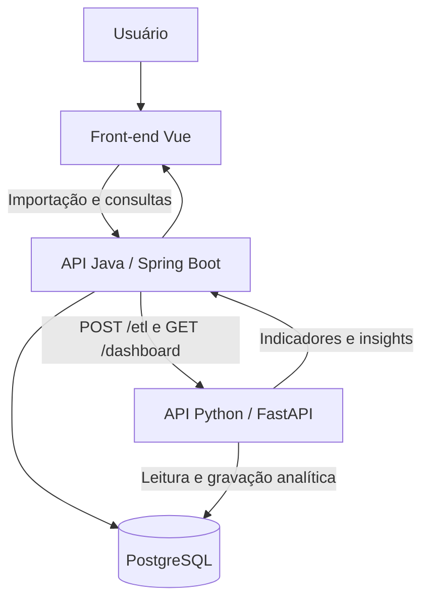

**Projeto Integrador** desenvolvido no 2º semestre de 2026 para o curso de **Análise e Desenvolvimento de Sistemas (ADS)** do **SENAI**, baseado na Situação de Aprendizagem proposta pela empresa **Provedor CTI**.

O **DataGear CTI** é uma aplicação web para importar, organizar e analisar dados da carteira de clientes. O usuário cadastra-se ou entra no sistema, importa uma planilha comercial, confere os dados e acompanha os indicadores no dashboard.

| Serviço | Endereço |
|---|---|
| Aplicação web (front-end) | [https://datagear.vercel.app](https://datagear.vercel.app) |
| API Java (back-end) | [https://backend-java-production-5e455b77.up.railway.app](https://backend-java-production-5e455b77.up.railway.app) |
| API de analytics (Python) | [https://analytics-python-production.up.railway.app](https://analytics-python-production.up.railway.app) |
| Saúde da API Python | [GET /saude](https://analytics-python-production.up.railway.app/saude) |

---

## Unidades Curriculares Integradas

O projeto integra conhecimentos das seguintes áreas:

- **Frameworks Front-end:** desenvolvimento da interface e navegação da aplicação.
- **Desenvolvimento Back-end:** criação de APIs, regras de negócio e integração com banco de dados.
- **Ciência de Dados:** limpeza, transformação e análise estatística dos dados.
- **Automação Industrial:** integração de dados e conceitos de monitoramento, conforme os requisitos do projeto.
- **Computação em Nuvem:** publicação e comunicação dos serviços hospedados.
- **Relações Humanas e Cidadania:** atenção à usabilidade, acessibilidade e tratamento responsável dos dados.

## Funcionalidades

**Acesso e cadastro**

- Criar cadastro de consultor com nome, e-mail, telefone e senha.
- Entrar com e-mail e senha.

**Clientes e planilhas**

- Consultar clientes, pesquisar por texto e filtrar por segmento e status.
- Importar arquivos `.xlsx`, `.xls` e `.csv`.
- Conferir campos obrigatórios, códigos duplicados, nível, UF, faturamento e segmento antes do envio.
- Exibir erros de validação e encaminhar os registros para o processamento Python.
- Atualizar clientes existentes ou inserir novos, usando o código do cliente como chave lógica.
- Encerrar um cliente.

**Dashboard**

- Consultar total de clientes, faturamento total e médio e serviço mais contratado.
- Visualizar faturamento por segmento, clientes por nível e contratações por mês.
- Consultar medidas estatísticas, os cinco maiores clientes e insights gerados a partir dos dados.

## Tecnologias

| Camada | Tecnologias principais |
|---|---|
| Front-end | Vue 3, Vite, Vue Router, Pinia, Tailwind CSS, Axios, Chart.js, SheetJS (`xlsx`) e AOS |
| Back-end | Java 17, Spring Boot 4.1.1, Spring Web MVC, Spring Data JPA, Spring Security e Bean Validation |
| Ciência de dados | Python, FastAPI, Uvicorn, pandas, NumPy, SciPy e SQLAlchemy |
| Banco de dados | PostgreSQL |
| Hospedagem | Vercel (front-end) e Railway (APIs) |

## Fluxo de dados



1. O usuário seleciona uma planilha no front-end.
2. O navegador lê e valida os dados e mostra os problemas encontrados.
3. O front-end envia os registros para `POST /api/cliente/importar` na API Java.
4. A API Java encaminha a importação para `POST /etl` no serviço Python.
5. O Python trata os dados, grava clientes e insights no PostgreSQL e calcula os indicadores.
6. O dashboard solicita os dados à API Java, que consulta o serviço Python.

## Banco de dados

O sistema utiliza PostgreSQL. O back-end Java mapeia entidades como `cliente`, `consultor`, `contrato`, `servico`, `insight` e `telemetria`. O serviço Python acessa a tabela `public.cliente` para gravar e consultar clientes e registra os insights produzidos pelo processamento.

O ETL usa `codigo_cliente` como chave lógica para inserir ou atualizar clientes. A importação atual não cria contratos: os dados fornecidos pela planilha não contêm todos os campos necessários para formar um contrato.

O Hibernate está configurado com `spring.jpa.hibernate.ddl-auto=validate`, portanto o schema PostgreSQL deve existir e ser compatível com as entidades antes de iniciar o back-end.

## Estrutura do repositório

```text
frontend-vue/       Aplicação Vue e dashboard
backend-java/       API REST, entidades JPA e integração com analytics
analytics-python/   API FastAPI, ETL, análise e acesso ao PostgreSQL
```

## Como executar

**Pré-requisitos:** Node.js 22.18+ (ou 24.12+), Java 17, Python 3.10+ e acesso a um PostgreSQL com o schema esperado pela aplicação.

Configure as variáveis de ambiente e inicie os serviços nesta ordem.

### 1. Python (porta 8000)

```powershell
cd analytics-python
python -m venv .venv
.venv\Scripts\Activate.ps1
pip install -r requirements.txt
python -m uvicorn api:app --reload --port 8000
```

No Linux/macOS, ative o ambiente com `source .venv/bin/activate`.

### 2. Back-end Java (porta 8080)

```powershell
cd backend-java
.\mvnw.cmd spring-boot:run
```

No Linux/macOS, use `./mvnw spring-boot:run`.

### 3. Front-end (porta 5173)

```powershell
cd frontend-vue
npm install
npm run dev
```

Acesse o endereço exibido pelo Vite, normalmente `http://localhost:5173`.

### Variáveis de ambiente

| Serviço | Variáveis |
|---|---|
| `analytics-python` | `DB_USER`, `DB_PASSWORD`, `DB_HOST`, `DB_NAME`; opcionalmente `DB_PORT`, `DB_SSLMODE`, `ETL_API_KEY` e `LOG_LEVEL` |
| `backend-java` | `DB_PASSWORD`, `ANALYTICS_PYTHON_URL` e `ETL_API_KEY` |
| `frontend-vue` | A URL da API está atualmente configurada em `src/services/api.js` |

`ETL_API_KEY`, quando configurada, deve ter o mesmo valor nos serviços Python e Java. Não publique senhas ou chaves no repositório. O JDBC URL e o usuário do banco usados pelo Java estão em `backend-java/src/main/resources/application.properties`.

## API

| Método | Rota | Serviço | Função |
|---|---|---|---|
| `POST` | `/api/consultor` | Java | Cadastra consultor |
| `POST` | `/api/auth/login` | Java | Autentica consultor |
| `GET` | `/api/cliente/listar` | Java | Lista clientes |
| `POST` | `/api/cliente/importar` | Java | Encaminha a importação ao ETL |
| `GET` | `/api/cliente/dashboard` | Java | Retorna dados analíticos para o dashboard |
| `PATCH` | `/api/cliente/{id}/encerrar` | Java | Encerra um cliente |
| `GET` | `/saude` | Python | Verifica o serviço |
| `POST` | `/etl` | Python | Trata, analisa e persiste os dados recebidos |
| `GET` | `/dashboard` | Python | Calcula análise com os clientes persistidos |
| `POST` | `/testar` | Python | Testa limpeza e análise sem gravar no banco |

A API FastAPI também disponibiliza documentação interativa em `/docs` e `/redoc`.

## Testes

Os testes automatizados do back-end Java estão em `backend-java/src/test`. O serviço Python inclui `analytics-python/testar_conexao.py` para verificar a conexão com o banco e a rota `POST /testar` para exercitar limpeza e análise sem persistência.

Para gerar o build de produção do front-end:

```bash
cd frontend-vue
npm run build
```

## Documentação

- [Documentação do back-end Java](backend-java/README.md)
- [Documentação do front-end Vue](frontend-vue/README.md)
- [Documentação da ciência de dados e ETL](analytics-python/README.md)
