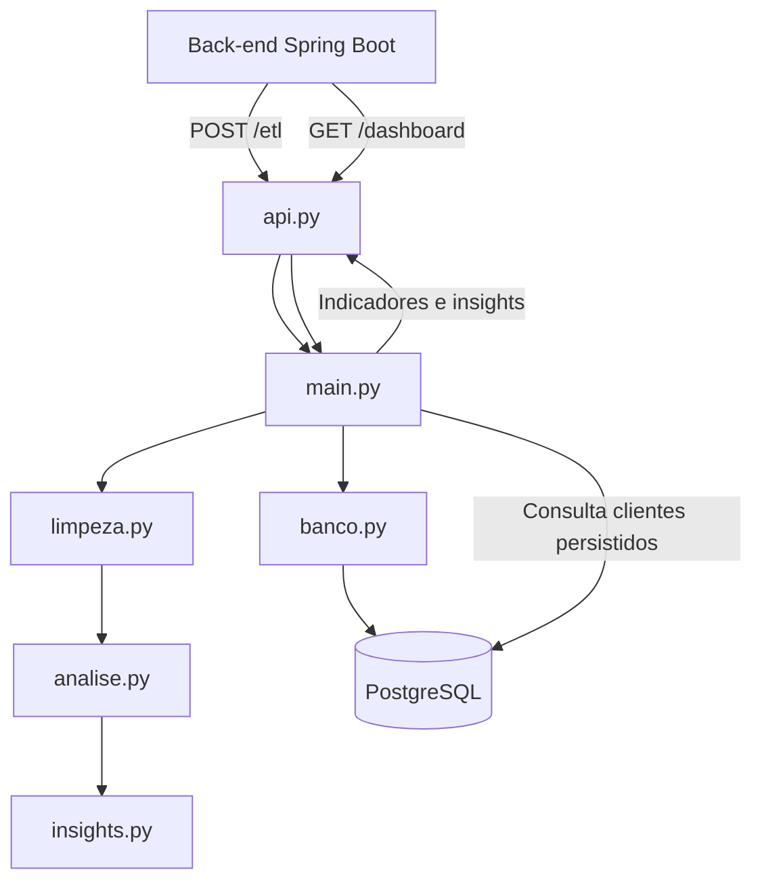

# DataGear CTI · Ciência de dados e ETL

Serviço analítico em Python responsável por receber dados do back-end Java, tratar e validar linhas de clientes, calcular indicadores e gerar insights em português. O serviço persiste os clientes e os insights no PostgreSQL e fornece os dados consultados pelo dashboard.

| Serviço | Endereço |
|---|---|
| API em produção | [https://analytics-datagear.up.railway.app](https://analytics-datagear.up.railway.app) |
| Verificação de saúde | [GET /saude](https://analytics-datagear.up.railway.app/saude) |
| Swagger UI | [Documentação /docs](https://analytics-datagear.up.railway.app/docs) |
| ReDoc | [Documentação /redoc](https://analytics-datagear.up.railway.app/redoc) |

## Tecnologias

| Pacote | Uso |
|---|---|
| FastAPI | Endpoints HTTP e documentação OpenAPI |
| Uvicorn | Servidor de desenvolvimento ASGI |
| Pydantic | Validação do corpo recebido pela API |
| pandas + NumPy | Tratamento tabular e cálculos |
| SciPy | Correlações estatísticas |
| SQLAlchemy + psycopg | Conexão e persistência no PostgreSQL |
| python-dotenv | Carregamento local das variáveis do `.env` |

## Fluxo dos dados



1. O Java envia as linhas para `POST /etl` e pode incluir a chave `X-ETL-Key`.
2. `api.py` valida o corpo e verifica a chave quando `ETL_API_KEY` estiver configurada.
3. `main.py` chama as rotinas de limpeza e análise.
4. As linhas inválidas são incluídas no resultado de qualidade; as válidas são inseridas ou atualizadas no banco.
5. `analise.py` calcula os indicadores e `insights.py` produz frases para o dashboard.
6. `GET /dashboard` consulta os clientes no PostgreSQL e recalcula os indicadores exibidos pela aplicação.

## Etapas do processamento

### Limpeza e validação · `limpeza.py`

- Remove espaços repetidos e padroniza textos.
- Padroniza nomes de consultores, segmentos, níveis e serviços reconhecidos.
- Converte faturamento em valor numérico, aceitando formatos comuns de moeda brasileira.
- Interpreta datas em formatos aceitos pelo código de limpeza.
- Rejeita linhas com dados obrigatórios ausentes ou inválidos, segmento não reconhecido, nível fora de A/B/C, faturamento inválido/negativo ou código duplicado.
- Retorna as linhas tratadas, as rejeitadas com o motivo e informações de padronização.

### Indicadores · `analise.py`

Calcula total de clientes, faturamento total, média, mediana, desvio padrão, mínimo, máximo, quartis e coeficiente de variação. Também prepara dados agregados por segmento, nível, consultor, serviço e mês, correlação entre quantidade de serviços e faturamento, maiores clientes e resumo da qualidade dos dados.

### Insights em texto · `insights.py`

Converte resultados em frases em português, como segmento com mais clientes, relação entre média e mediana, participação do nível A, consultor com maior faturamento, serviço mais contratado, pico mensal e correlação entre serviços e faturamento.

### Persistência · `banco.py`

Cria a conexão SQLAlchemy e grava os clientes válidos em `public.cliente`. A atualização usa `codigo_cliente` como chave lógica. Os insights são gravados em `public.insight`. O ETL atual não cria registros de lote, estatísticas de lote ou contratos.

## API

| Método | Rota | Função |
|---|---|---|
| `GET` | `/saude` | Retorna o status do serviço |
| `POST` | `/etl` | Valida, trata, analisa e persiste linhas válidas |
| `GET` | `/dashboard` | Calcula os indicadores usando clientes salvos |
| `POST` | `/testar` | Executa limpeza e análise sem conectar ao banco |

### `POST /etl`

O back-end Java envia um objeto JSON com `linhas` (lista de registros) e, opcionalmente, `recebidas` e `loteId`. O cabeçalho `X-ETL-Key` é comparado a `ETL_API_KEY` quando a variável não estiver vazia.

| Código HTTP | Situação |
|---|---|
| `200` | Processamento concluído; resposta inclui resumo, qualidade e análise |
| `401` | Chave do ETL ausente ou inválida, quando a chave está configurada |
| `422` | Lista de linhas vazia |
| `500` | Falha durante o processamento ou acesso ao banco |

Quando todas as linhas forem rejeitadas pelas regras de limpeza, o ETL retorna o resumo de qualidade sem gravar clientes.

### `POST /testar`

Recebe uma lista de registros, executa limpeza e análise e devolve o resultado calculado sem persistir dados. Requer pelo menos uma linha e ao menos uma linha válida.

## Estrutura

| Arquivo | Responsabilidade |
|---|---|
| `api.py` | Rotas FastAPI, modelos de entrada e verificação opcional de chave |
| `main.py` | Orquestra ETL e recalcula dashboard a partir do banco |
| `limpeza.py` | Limpeza, padronização e rejeição de linhas inválidas |
| `analise.py` | Indicadores, agrupamentos, correlação e qualidade |
| `insights.py` | Geração de análises textuais |
| `banco.py` | Conexão e gravação no PostgreSQL |
| `config.py` | Variáveis de conexão e URL SQLAlchemy |
| `testar_conexao.py` | Verifica conexão e presença de tabelas no PostgreSQL |
| `amostras/clientes.json` | Dados de exemplo para requisições de teste |
| `requirements.txt` | Dependências Python |

## Configuração

Copie `.env.example` para `.env` na pasta `analytics-python` e substitua os valores de exemplo:

| Variável | Obrigatória | Descrição |
|---|---:|---|
| `DB_HOST` | Sim | Host do PostgreSQL |
| `DB_NAME` | Sim | Nome do banco |
| `DB_USER` | Sim | Usuário do banco |
| `DB_PASSWORD` | Sim | Senha do banco |
| `DB_PORT` | Não | Porta; padrão `5432` |
| `DB_SSLMODE` | Não | Modo SSL; padrão `require` |
| `ETL_API_KEY` | Não | Chave compartilhada com o back-end Java |
| `LOG_LEVEL` | Não | Nível de log; padrão `INFO` |

Não versionar `.env` nem publicar credenciais. Em produção, cadastre essas variáveis na configuração do serviço Railway. Se `ETL_API_KEY` for definida, configure o mesmo valor na variável `ETL_API_KEY` do back-end Java.

## Execução local

**Pré-requisito:** Python 3.10+ e acesso ao PostgreSQL com as tabelas `cliente` e `insight` compatíveis.

```powershell
cd analytics-python
python -m venv .venv
.venv\Scripts\Activate.ps1
pip install -r requirements.txt
python -m uvicorn api:app --reload --port 8000
```

No Linux/macOS, ative o ambiente com `source .venv/bin/activate`. A API fica disponível em `http://localhost:8000`; a documentação interativa fica em `http://localhost:8000/docs`.

## Testes e verificações

Verifique a conexão do banco a partir da pasta do serviço:

```bash
python testar_conexao.py
```

Para testar a transformação sem gravar, inicie o serviço e envie uma lista de linhas para `POST /testar` pela documentação `/docs`. Os testes automatizados existentes na raiz do back-end Java estão em `backend-java/src/test`.
