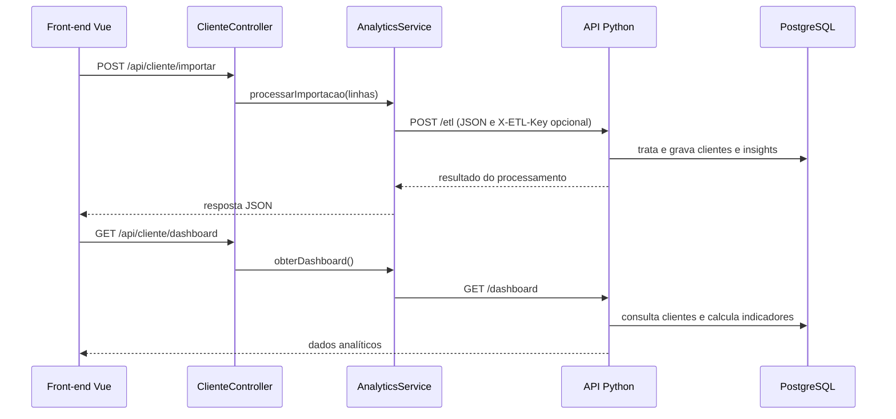

# Back-end · DataGear CTI

> API REST em Java 17 e Spring Boot 4.1.1. Recebe operações do front-end, consulta clientes e delega o processamento analítico ao serviço Python.

  

## O que o back-end faz

- Recebe o cadastro e o login de consultores.
- Expõe operações de consulta e atualização de clientes.
- Encaminha importações para o serviço Python por `POST /etl`.
- Consulta os resultados analíticos do Python para o dashboard.
- Usa Spring Data JPA para mapear entidades e acessar o PostgreSQL.

O login confere a senha com BCrypt. A resposta atual contém os dados do consultor e a interface mantém essa resposta no `localStorage`; a implementação atual não emite JWT. O `SecurityConfig` também permite as requisições HTTP, então as rotas da API não devem ser interpretadas como protegidas por token.

## Estrutura de pastas

```text
backend-java/
├── pom.xml
├── mvnw / mvnw.cmd
└── src/
    ├── main/java/com/example/backend_java/
    │   ├── config/       Configuração de segurança, CORS e RestClient
    │   ├── controller/   Endpoints HTTP
    │   ├── dto/          Objetos de entrada e saída
    │   ├── model/        Entidades JPA e enums
    │   ├── repository/   Repositórios Spring Data
    │   └── service/      Regras de aplicação e integração analítica
    ├── main/resources/
    │   └── application.properties
    └── test/java/        Testes automatizados
```

## Mapa dos arquivos

| Arquivo | Responsabilidade |
|---|---|
| `BackendJavaApplication.java` | Inicializa a aplicação Spring Boot |
| `config/SecurityConfig.java` | Configura BCrypt, CORS e regras HTTP |
| `config/RestClientConfig.java` | Configura o cliente HTTP do Spring |
| `controller/ClienteController.java` | Importação, listagem, dashboard e encerramento de clientes |
| `controller/AuthController.java` | Autenticação de consultor |
| `controller/ConsultorController.java` | Cadastro e operações de consultores |
| `service/AnalyticsService.java` | Chama os endpoints `/etl` e `/dashboard` do serviço Python |
| `model/` e `repository/` | Mapeamento e acesso às tabelas PostgreSQL |
| `src/main/resources/application.properties` | Configuração do banco e endereço do Python |
| `pom.xml` | Versão do Java, dependências e plugin Maven |

## Fluxo de importação e dashboard



## Instalar e executar

**Pré-requisitos:** Java 17 e acesso a PostgreSQL com o schema compatível com as entidades.

Configure as variáveis necessárias e inicie o serviço Python antes de testar importação ou dashboard.

```powershell
cd backend-java
$env:DB_PASSWORD = "sua-senha-do-banco"
$env:ANALYTICS_PYTHON_URL = "http://localhost:8000"
.\mvnw.cmd spring-boot:run
```

No Linux/macOS:

```bash
cd backend-java
export DB_PASSWORD="sua-senha-do-banco"
export ANALYTICS_PYTHON_URL="http://localhost:8000"
./mvnw spring-boot:run
```

Por padrão, o Spring Boot inicia na porta `8080`. O schema precisa existir previamente: `spring.jpa.hibernate.ddl-auto=validate` valida o mapeamento, mas não cria tabelas.

## Configuração

| Variável | Uso |
|---|---|
| `DB_PASSWORD` | Senha do PostgreSQL |
| `ANALYTICS_PYTHON_URL` | URL base do serviço Python; padrão `http://localhost:8000` |
| `ETL_API_KEY` | Chave opcional enviada ao Python no cabeçalho `X-ETL-Key` |

O JDBC URL e o usuário do banco estão configurados em `src/main/resources/application.properties`. O Python e o Java devem receber o mesmo valor de `ETL_API_KEY` quando a chave estiver habilitada no Python.

## Rotas da API

| Método | Rota | Descrição |
|---|---|---|
| `POST` | `/api/auth/login` | Confere e-mail e senha do consultor |
| `POST` | `/api/consultor` | Cadastra consultor |
| `GET` | `/api/consultor` | Lista consultores |
| `POST` | `/api/cliente/importar` | Encaminha as linhas ao ETL Python |
| `GET` | `/api/cliente/dashboard` | Obtém a análise do serviço Python |
| `GET` | `/api/cliente/listar` | Lista clientes persistidos |
| `PATCH` | `/api/cliente/{id}/encerrar` | Altera o status do cliente |
| `DELETE` | `/api/cliente/deletar` | Remove todos os clientes |

O controller de consultor também declara rotas `GET` e `DELETE`, mas a implementação de remoção ainda está vazia. Os controladores de contrato, serviço, insight e telemetria expõem operações próprias; alguns métodos ainda retornam `null` ou não executam a operação, então confira os respectivos controllers antes de depender deles.

## Deploy

O back-end está publicado em [Railway](https://backend-java-production-5e455b77.up.railway.app). No serviço de produção, configure `DB_PASSWORD`, `ANALYTICS_PYTHON_URL` e, se utilizada, `ETL_API_KEY`. A URL do Python deve ser `https://analytics-python-production.up.railway.app`.

O CORS está configurado em `SecurityConfig.java`, incluindo o front-end publicado e os endereços locais de desenvolvimento.

## Testes

Os testes ficam em `src/test/java/com/example/backend_java/`. Para executá-los:

```powershell
cd backend-java
.\mvnw.cmd test
```

No Linux/macOS, use `./mvnw test`.
