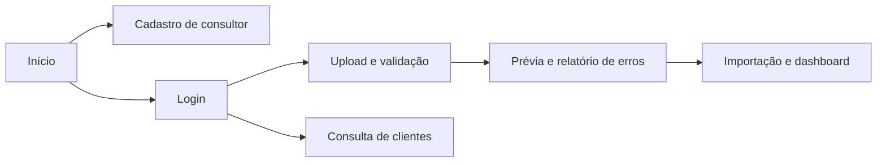
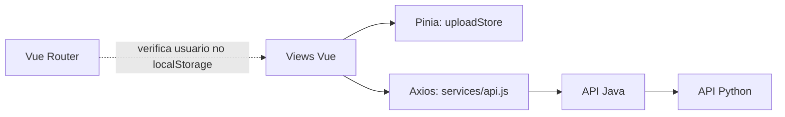

# Front-end · DataGear CTI

Interface web do DataGear CTI, desenvolvida em Vue 3. Permite cadastrar e autenticar consultores, importar planilhas de clientes, consultar a base e visualizar indicadores em um dashboard.

**Aplicação publicada:** [https://datagear.vercel.app](https://datagear.vercel.app)

## Tecnologias

| Pacote | Uso |
|---|---|
| Vue 3 | Componentes e interface com Composition API |
| Vite | Servidor de desenvolvimento e build de produção |
| Vue Router | Rotas e controle de navegação |
| Pinia | Estado da importação de planilhas |
| Axios | Requisições HTTP para a API Java |
| Tailwind CSS 4 | Estilização das telas |
| SheetJS (`xlsx`) | Leitura de arquivos Excel e CSV no navegador |
| Chart.js | Gráficos do dashboard |
| AOS | Animações de entrada |

## Experiência do usuário

### Jornada principal



Na tela de upload, a pessoa seleciona um arquivo ou usa a planilha modelo, confere a prévia e as validações e inicia a importação. A API Python realiza a validação definitiva e pode devolver linhas rejeitadas, que aparecem no relatório.

### Recursos da interface

- Área de seleção de arquivo que aceita `.xlsx`, `.xls` e `.csv`.
- Prévia dos primeiros registros e resumo das linhas e erros identificados.
- Relatório com linha, campo e motivo da rejeição.
- Tela de clientes com busca e filtros por segmento e status.
- Dashboard com indicadores, gráficos, estatísticas, insights e maiores clientes.
- Layout responsivo com estados de carregamento, erro e ausência de dados.

## Arquitetura

As telas usam Axios para chamar a API Java. O estado de importação é mantido pela store Pinia; os dados do usuário ficam no `localStorage`.



O controle de rota no Vue melhora a navegação, mas não substitui a autorização na API. No estado atual, o back-end não emite JWT e permite as requisições segundo sua configuração de segurança.

## Estrutura

```text
src/
├── assets/       CSS, imagens, logo e planilha modelo
├── components/  Cabeçalho e rodapé
├── router/      Rotas e guarda de navegação
├── services/    Cliente Axios
├── stores/      Estado e validação da importação
├── views/       Home, login, cadastro, upload, clientes e dashboard
├── App.vue
└── main.js
```

## Estado da importação

`src/stores/uploadStore.js` mantém o arquivo selecionado, dados originais e tratados, erros e estado de processamento. A store:

1. Lê a primeira aba da planilha, priorizando `upload_clientes` quando disponível.
2. Limpa espaços e padroniza alguns segmentos e níveis.
3. Verifica campos obrigatórios, códigos duplicados, nível (`A`, `B` ou `C`), UF, faturamento e segmento.
4. Envia os dados para `POST /api/cliente/importar`.
5. Inclui no relatório os motivos de rejeição retornados pelo ETL Python.

O navegador faz uma pré-validação para orientar a pessoa; a validação final ocorre no serviço Python.

### Colunas esperadas

```text
codigo_cliente, nome_cliente, consultor, segmento, nivel_cliente,
faturamento_anual, servicos_contratados, status, data_contratacao,
cidade, uf
```

## Vue Router

As rotas estão em `src/router/index.js`:

| Rota | Tela | Comportamento |
|---|---|---|
| `/` | `Home.vue` | Página inicial |
| `/login` | `Login.vue` | Login de consultor |
| `/cadastro` | `Cadastro.vue` | Cadastro de consultor |
| `/clientes` | `Clientes.vue` | Requer usuário salvo no navegador |
| `/upload` | `Upload.vue` | Requer usuário salvo no navegador |
| `/dashboard` | `Dashboard.vue` | Requer usuário salvo no navegador |

Rotas não reconhecidas redirecionam para a página inicial.

## Dashboard

A tela `/dashboard` consome `GET /api/cliente/dashboard` e apresenta indicadores retornados pelo Python, incluindo faturamento por segmento, distribuição por nível, contratações por mês, resumo estatístico, insights e os cinco maiores clientes.

## Configuração e execução

O endereço da API está configurado no `baseURL` de `src/services/api.js`. Localmente, altere-o para `http://localhost:8080/` e restaure a URL de produção para publicar a aplicação.

**Pré-requisito:** Node.js `^22.18.0` ou `>=24.12.0`, conforme o `package.json`.

```bash
npm install
npm run dev
```

O Vite inicia normalmente em `http://localhost:5173`. O back-end Java e o serviço Python precisam estar ativos para operações que dependem da API e do banco.

## Build e deploy

```bash
npm run build
npm run preview
```

O build de produção é gerado em `dist/`. O arquivo `vercel.json` redireciona URLs da aplicação para `index.html`, permitindo navegação direta pelas rotas do Vue Router.
